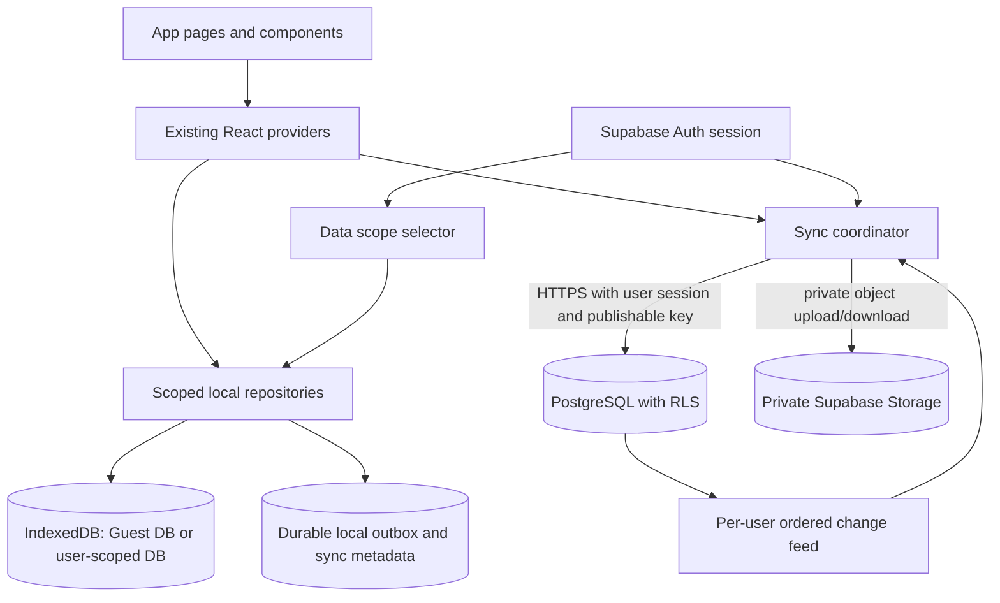
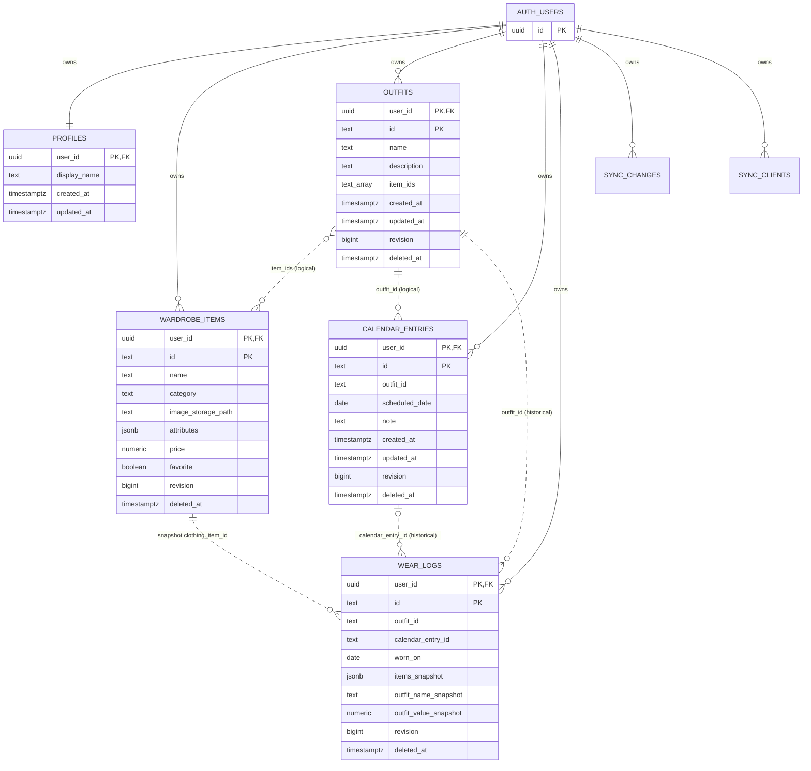

# Guest Mode, Authentication, and Cloud Sync Architecture

**Status:** design proposal; no authentication, backend, migration, or UI has been implemented.

## Executive summary

Keep the current application local-first and make account use opt-in. The four existing providers should continue to be the UI's data interface. Add an authentication/session boundary and a synchronization service beneath them; components should not issue database or Storage requests directly.

Recommended direction:

- Supabase Auth for optional account identity and session management.
- Supabase PostgreSQL for owned records, sync revisions, and a durable change feed.
- A private Supabase Storage bucket for user-uploaded clothing images.
- IndexedDB remains the source of truth for the current device and supports guest and offline use.
- Use a separate IndexedDB database per data scope (the existing `virtual-wardrobe` remains the legacy Guest scope; authenticated scopes are keyed by Supabase user ID). This avoids mixing guest and account records or exposing one signed-in user's local data to another through the current singleton database.
- Add a durable local outbox and a server-issued per-user change sequence. Use mutation IDs and revision checks for idempotency and conflicts. `updatedAt` alone is not a synchronization protocol.
- Never clear local data automatically. Restore and merge are explicit, previewed actions with resumable progress.

The local database must be extended only after this design and its migration are reviewed. The proposed cloud tables below are not migrations.

## 1. Current architecture audit

### Application and identity

- The application is a Next.js App Router application with React and TypeScript. `next` is 16.4.3; no Supabase/Auth package, auth route, API route, or authentication model is present in the inspected source/package manifest.
- The root layout mounts `WardrobeProvider > OutfitProvider > CalendarProvider > WearLogProvider > AppShell`. Calendar consumes OutfitProvider; WearLogProvider consumes OutfitProvider and WardrobeProvider. `PwaRegistration` is mounted outside those providers.
- Profile statistics are derived from the four providers. The page labels itself “Your profile” and “Your wardrobe, saved locally”; it has no account identity, editable name, or avatar model. The Home menu likewise shows “Local wardrobe”.
- The PWA caches only `/offline.html` for failed navigations. It does not cache application data or IndexedDB. The worker is registered in production; development code removes only this app's worker registration and `virtual-wardrobe-offline-*` caches. That cleanup does not touch IndexedDB.

Relevant files: [`app/layout.tsx`](../app/layout.tsx), [`components/providers/wardrobe-provider.tsx`](../components/providers/wardrobe-provider.tsx), [`components/providers/outfit-provider.tsx`](../components/providers/outfit-provider.tsx), [`components/providers/calendar-provider.tsx`](../components/providers/calendar-provider.tsx), [`components/providers/wear-log-provider.tsx`](../components/providers/wear-log-provider.tsx), [`components/profile/profile-statistics.tsx`](../components/profile/profile-statistics.tsx), [`components/home/dashboard-header.tsx`](../components/home/dashboard-header.tsx), [`components/pwa/pwa-registration.tsx`](../components/pwa/pwa-registration.tsx), [`public/service-worker.js`](../public/service-worker.js).

### IndexedDB and local persistence

- `lib/image-storage.ts` opens database `virtual-wardrobe`, version 5. Stores are `images`, `wardrobe`, `metadata`, `outfits`, `calendar`, and `wearLogs`, each keyed by `id`.
- Upgrade handling creates missing stores and does not rename/delete existing stores. The v5 schema has no account owner, device identity, per-record revision, change cursor, or outbox.
- `metadata` currently contains the `wardrobe-initialized` marker. On a never-initialized, empty wardrobe, `initializeWardrobe(seedItems)` writes the 12 bundled starter items. There is no field distinguishing a seed item from an item subsequently created/edited by a user; treat all stored records as user-visible data during transfer unless a reviewed migration adds provenance.
- Clothing, outfit, and calendar bulk persistence clears and rewrites that store. Providers serialize their own queued writes, but those queues do not coordinate tabs or devices. Their CRUD methods update in-memory state and enqueue persistence; callers generally cannot await a successful IndexedDB commit. Persistence errors are displayed/retryable.
- WearLog operations include a serialized provider queue and individual create/delete functions. The record is appended to UI state only after the individual IndexedDB create succeeds.
- IndexedDB transactions and provider APIs are local only. There is no remote snapshot, cloud cursor, offline outbox, tombstone, or cross-device conflict mechanism.

Relevant file: [`lib/image-storage.ts`](../lib/image-storage.ts).

### Models, identifiers, and relationships

| Entity | Current fields and local behavior | Synchronization implications |
|---|---|---|
| Clothing item | `ClothingItem` in `lib/wardrobe-data.ts`: `id`, name, category, image string, alt text, color, brand, seasons, styles, numeric price, status, favorite. No `createdAt`/`updatedAt`. | Mostly independent. `image` is either an app public path or an `idb-image:<UUID>` reference. Deleting an item does not cascade to outfits. |
| Outfit | `id`, name, description, `itemIds: string[]`, `createdAt`, `updatedAt`, favorite. | Logical references to wardrobe IDs; missing IDs are explicitly reported by `resolveOutfitItems`. Current outfit deletion does not cascade. |
| Calendar entry | `id`, `outfitId`, date, note, `createdAt`, `updatedAt`. | Logical reference to an outfit. Missing outfit references are reported; deleting an outfit does not delete the entry. |
| WearLog | `id`, `outfitId`, nullable `calendarEntryId`, `wornOn`, note, item snapshots, outfit name/value, `createdAt`. | Historical record includes snapshots of item ID/name/category/brand/price and outfit name/value. It intentionally survives outfit, clothing, or calendar deletion. It contains no image Blob or image snapshot. |
| Image Blob | `images` store record `{ id, blob }`; references have prefix `idb-image:` and UUIDs. | Must be uploaded separately and linked by a cloud Storage path; local reference cannot be used as a cloud URL. |

`resolveOutfitItems` identifies missing clothing references. `findMissingOutfitReferences` identifies missing outfit references. These checks are important because existing deletion semantics preserve dangling logical references rather than cascading.

Existing entity IDs are strings. Seed items have fixed human-readable IDs; provider-generated clothing, outfit, calendar, and wear-log IDs use a timestamp plus `Math.random()`. Image IDs use `crypto.randomUUID()`. Existing IDs can and should be retained for initial account transfer and for composite `(user_id, id)` keys, but generated IDs are not guaranteed globally unique across devices. A reviewed follow-up should use `crypto.randomUUID()` for new record IDs, while preserving all existing ones.

Prices are a compatibility edge case: `ClothingItem.price` is a number; the add form currently defaults missing price to `0`. WearLog snapshots represent unknown price as `null`, and non-positive prices are not considered known. The cloud mapping must treat existing `0` as unknown, not as free. A future model change to `number | null` requires a separately reviewed local-data migration.

Relevant files: [`lib/wardrobe-data.ts`](../lib/wardrobe-data.ts), [`lib/calendar-data.ts`](../lib/calendar-data.ts), [`lib/wear-log-data.ts`](../lib/wear-log-data.ts), [`components/closet/add-clothing-form.tsx`](../components/closet/add-clothing-form.tsx).

### Images and deletion details

- `saveImage`, `getImage`, and `deleteImage` operate on the local `images` store. `useClothingImage` resolves `idb-image:` values to temporary object URLs; non-IDB paths are rendered directly.
- The 12 current seed items use bundled `/images/closet/...` paths. Those are app assets, not user Blobs; they do not need per-user Storage uploads. Keep asset paths distinct from private user-image paths.
- The clothing form stores the new Blob before updating the ClothingItem. On image replacement, it currently deletes the old Blob before the provider's queued wardrobe persistence has reported success. That existing ordering creates a local failure window and should be corrected or safely compensated before adding cloud image cleanup.
- The local provider delete operations remove records but do not create tombstones. Removing images is an explicit operation, not a cascaded wardrobe delete in the provider.
- Outfit and calendar records have no hard foreign keys. WearLogs are self-contained historical snapshots and should remain readable even when live records are deleted.

### Provider and write semantics

- WardrobeProvider exposes `items`, `addItem`, `updateItem`, `deleteItem`, `toggleFavorite`, `storageError`, and `retryStorage`.
- OutfitProvider exposes outfit CRUD/favorite methods and persistence status/retry.
- CalendarProvider exposes entry CRUD, missing-outfit diagnostics, date lookup, and persistence status/retry.
- WearLogProvider exposes `addWearLog`, `recordWearFromCalendar`, `deleteWearLog`, date/outfit lookups, and persistence status/retry. Calendar-derived wears snapshot current outfit/wardrobe values and prevent duplicate calendar-linked wears locally.
- Existing write APIs are not one uniform asynchronous repository contract. Some mutate local UI state before durable persistence; WearLog mutations are awaited. A cloud outbox must not report a cloud-synced success before a durable local write and durable pending operation exist.

## 2. Target architecture



Keep component APIs provider-oriented. Auth establishes an optional `guest` or `account:<user-id>` data scope. A repository abstraction selects and validates that scope. Providers continue to load and mutate local records; the sync coordinator observes durable local operations and applies/reads remote deltas. Only the auth/sync layer knows Supabase details.

Recommended modules (names illustrative):

- `AuthProvider` / session service: optional sign-in, sign-out, session restoration and account-switch events.
- `DataScopeProvider`: resolves Guest versus authenticated user scope before mounting data providers; never briefly mount one user's provider state in another scope.
- Local repositories: preserve current IndexedDB behavior but add an explicit database/scope argument and transactionally record account-scope outbox mutations.
- `SyncCoordinator`: initial transfer, incremental pull/push, retry, conflict, and progress state.
- Supabase adapter: Auth, PostgREST/RPC, and Storage calls behind the sync coordinator.

Do not put a user ID on public/bundled assets or accept a client-supplied owner ID as authorization. The authenticated identity comes from `auth.uid()`/verified session claims.

### Local database scoping proposal

The current singleton database has no owner field, so it cannot safely represent guest data and multiple accounts at once. Preferred option: keep `virtual-wardrobe` as the legacy Guest database and create one database per signed-in user, such as `virtual-wardrobe-user-<auth-user-id>`. Both use the same local stores initially. This avoids key collisions and account switching overwriting the same `id` rows.

The database selector must be resolved before providers load. Authenticated scopes must not run guest seed initialization. Guest starter seeding remains limited to the existing Guest database. Account databases may start empty or restore cloud content.

Add reviewed local stores (or equivalent transactional metadata) for outbox, per-scope sync status/cursor, and staging/transfer checkpoints. Do not delete the legacy database during account creation, merge, restore, sign-out, or account switching. The precise IndexedDB version and upgrade plan remain to be designed and tested.

## 3. Entity relationship diagram

Dashed relationships below are logical ID references, not deletion-cascading foreign keys. This is intentional to preserve current missing-reference diagnostics and WearLog snapshots.



## 4. PostgreSQL schema proposal

All user-owned rows use composite primary key `(user_id, id)` so existing string IDs can be retained without collisions between different users. All timestamps are `timestamptz` in UTC; calendar/worn dates remain SQL `date` values because the current app models them as local `YYYY-MM-DD` keys.

### `profiles`

| Column | Type | Constraints / purpose |
|---|---|---|
| `user_id` | `uuid` | PK and FK to `auth.users(id)`, `ON DELETE CASCADE` only as part of explicit account erasure. |
| `display_name` | `text null` | Optional app profile label; do not copy email or provider identity claims into public profile fields by default. |
| `created_at`, `updated_at` | `timestamptz` | Server-managed. |

RLS permits a user to select/update only the row whose `user_id = auth.uid()`. Profile creation should be an idempotent trigger or authenticated RPC; clients cannot create a profile for another user.

### `wardrobe_items`

| Column | Type | Constraints / purpose |
|---|---|---|
| `user_id` | `uuid` | FK to `auth.users`; part of PK. |
| `id` | `text` | Existing ClothingItem ID; part of PK. |
| `name`, `category`, `image_alt`, `color`, `brand` | `text` | Required; `category` constrained to the current ClothingCategory values. |
| `image_kind` | `text` | `storage` or `app_asset`; distinguishes user Blobs from bundled public paths. |
| `image_storage_path` | `text null` | Private Storage object path for user uploads; null for an app asset. |
| `image_asset_path` | `text null` | Bundled path such as `/images/closet/...`; null for a user Blob. A check constraint ensures exactly the appropriate reference is used. |
| `seasons`, `styles` | `text[]` | Required arrays; optionally validated against current values without rejecting future app-defined labels. |
| `price` | `numeric(12,2) null` | Null means unknown. Map current local `0`/non-positive values to unknown; never infer free. |
| `status` | `text` | Current status enum; review whether mutable “Worn recently” status remains useful once actual WearLogs are authoritative. |
| `favorite` | `boolean` | Required. |
| `revision` | `bigint` | Server-controlled monotonically increasing entity revision. |
| `updated_at` | `timestamptz` | Server time for display/diagnostics; not conflict ordering by itself. |
| `deleted_at` | `timestamptz null` | Soft-delete tombstone. |
| `last_mutation_id` | `uuid` | Idempotency/debug identifier for accepted mutation. |

PK `(user_id, id)`. Add an index on `(user_id, deleted_at)` for active listing and a partial index for active item queries if needed. No hard FK to images; Storage paths are authorized separately. No cascade from item deletion into outfits or WearLogs.

### `outfits`

| Column | Type | Constraints / purpose |
|---|---|---|
| `user_id`, `id` | `uuid`, `text` | Owner and existing string ID; composite PK. |
| `name`, `description` | `text` | Current values. |
| `item_ids` | `text[]` | Preserve existing ordering and missing IDs. Do not turn into cascading join-table FKs without changing deletion semantics. |
| `created_at`, `updated_at` | `timestamptz` | Preserve parsed local timestamps on first import; server revision remains authoritative for concurrency. |
| `favorite` | `boolean` | Current value. |
| `revision`, `deleted_at`, `last_mutation_id` | `bigint`, `timestamptz null`, `uuid` | Sync/version/tombstone fields. |

PK `(user_id, id)`. Index active rows by `(user_id, deleted_at)`. `item_ids` are logical references; no FK cascade to wardrobe items.

### `calendar_entries`

| Column | Type | Constraints / purpose |
|---|---|---|
| `user_id`, `id` | `uuid`, `text` | Owner and existing string ID; composite PK. |
| `outfit_id` | `text` | Logical reference retained if outfit is deleted. |
| `scheduled_date` | `date` | Current `YYYY-MM-DD` value. |
| `note` | `text` | Current value. |
| `created_at`, `updated_at` | `timestamptz` | Existing local timestamps. |
| `revision`, `deleted_at`, `last_mutation_id` | sync fields | As above. |

PK `(user_id, id)`. Index `(user_id, scheduled_date)` for calendar views and `(user_id, deleted_at)` for active reads. Do not add a unique `(outfit_id, scheduled_date)` constraint: current local data/API do not prohibit multiple entries on a date. `outfit_id` has no hard FK so deleting an outfit preserves the scheduled entry and its current missing-reference UX.

### `wear_logs`

| Column | Type | Constraints / purpose |
|---|---|---|
| `user_id`, `id` | `uuid`, `text` | Owner and existing ID; composite PK. |
| `outfit_id` | `text` | Historical logical ID; retain after outfit deletion. |
| `calendar_entry_id` | `text null` | Historical logical ID; retain after calendar-entry deletion. |
| `worn_on` | `date` | Actual confirmation date. |
| `note` | `text` | Current note. |
| `items_snapshot` | `jsonb` | Validated list of `{clothingItemId, name, category, brand, price}`; no image content. |
| `outfit_name_snapshot` | `text` | Historical name. |
| `outfit_value_snapshot` | `numeric(12,2) null` | Null when any item price is missing/non-positive. |
| `created_at`, `revision`, `deleted_at`, `last_mutation_id` | timestamps/version fields | Sync metadata; snapshots themselves are immutable after creation. |

PK `(user_id, id)`. Partial unique index `(user_id, calendar_entry_id) WHERE calendar_entry_id IS NOT NULL` prevents duplicate calendar-linked wears even if two clients race. Index `(user_id, worn_on DESC)` and `(user_id, outfit_id)`. Do not add FKs to outfit, calendar, or wardrobe rows; no entity deletion may cascade into historical logs. No foreign key on `items_snapshot[*].clothingItemId`.

### Sync support tables

These are required for robust incremental sync and are separate from the five domain tables:

- `sync_clients(user_id, device_id, last_pulled_seq, registered_at, last_seen_at)`, PK `(user_id, device_id)`. Used for diagnostics and optional tombstone-retention decisions; do not use it as an authorization source.
- `sync_changes(user_id, seq, entity_type, entity_id, operation, revision, mutation_id, changed_at)`, PK `(user_id, seq)`. Append one change per committed mutation in the same PostgreSQL transaction as the entity write. Index `(user_id, seq)`. Retain delete events.
- `sync_mutations(user_id, mutation_id, entity_type, entity_id, result_revision, result_seq, created_at)`, PK `(user_id, mutation_id)`. Makes retries idempotent and returns the original accepted result.
- Optional `sync_user_cursors(user_id, next_seq)` or an equivalent locked counter. Allocate per-user sequence values atomically so concurrent writes have an unambiguous change-feed order.

All support tables are RLS protected by `user_id = auth.uid()`. Prefer authenticated RPCs or tightly scoped SQL functions for compare-and-swap writes, revision allocation, idempotency, and change-feed insertion. Any `SECURITY DEFINER` routine must set a fixed safe `search_path`, check `auth.uid()`, and expose no cross-user operation.

## 5. RLS and Storage security design

### PostgreSQL RLS

Enable RLS on every user-owned domain and sync table. Representative policy pattern:

```sql
USING (user_id = (select auth.uid()))
WITH CHECK (user_id = (select auth.uid()))
```

For `profiles`, use `user_id = auth.uid()`. Policies must cover SELECT, INSERT, UPDATE, and DELETE (or disallow direct DELETE and require a tombstone RPC). Never trust an incoming `user_id`; derive it from the verified session in the database. Test policies using at least two users and the unauthenticated role.

Use composite keys and user ownership in every query/RPC. RLS is defense in depth, not a substitute for scoping every local database and every sync operation.

### Private Storage

- Create one private bucket, e.g. `clothing-images`; no public read URLs.
- Store user uploads under `<auth.uid()>/<clothing-item-id>/<sha256-or-content-version>`. Use immutable/versioned paths and `upsert: false`; bind metadata rows only after upload succeeds.
- Storage object policies check `bucket_id` and the first path segment equals `auth.uid()` for SELECT/INSERT/DELETE. Enforce file size and allowed image MIME types; do not accept arbitrary path traversal or another user's object path.
- Store only the Storage path in PostgreSQL. Download with the authenticated SDK or short-lived signed URLs; avoid persisting signed URLs in ClothingItem or IndexedDB.
- Delete old objects only after the row update is committed and no live row, pending sync mutation, rollback window, or retention policy needs the object. Add an explicit orphan cleanup process later; do not broadly delete objects by prefix from the browser.

## 6. Guest-to-account migration flows

All flows start by preserving the current Guest database. Never clear or repurpose it automatically. Freeze/snapshot a stable local dataset for preview, validate records/references, and record a resumable transfer checkpoint. If the user edits during a transfer, either pause writes briefly or capture a snapshot and enqueue subsequent edits separately.

### A. New account; local Guest data exists

1. Authenticate and confirm the cloud account has no existing domain rows (a race-safe server check, not only a client query).
2. Show what will be transferred: item/outfit/calendar/WearLog counts, uploaded image count/bytes, missing references, price values mapped to unknown, and any invalid records.
3. Explicitly confirm “Back up this Guest wardrobe to this account.”
4. Upload IDB image Blobs to private Storage first. Verify object path, size/hash, and access. Reuse fixed public app-asset paths for bundled images; do not upload them as user photos.
5. Upsert records preserving local IDs and snapshots. Use dependency order for usability (wardrobe and image refs, outfits, calendar entries); WearLogs are self-contained but upload before marking transfer complete. Missing references are reported and preserved as logical IDs, not silently dropped.
6. Use per-record idempotency IDs and a transfer manifest/checkpoint. Retry only incomplete operations; do not duplicate records or images.
7. Verify remote records, snapshot hashes/counts, and all required image objects. Only then report backup success.
8. Copy/restore the verified account dataset into a separate account-scoped IndexedDB database, set its sync cursor, and switch the UI to account scope. Keep `virtual-wardrobe` (Guest) intact and unchanged as a recovery copy.

If any step fails, keep the Guest database active, display partial progress and the failed stage, and allow retry/resume. Do not say “backed up” merely because an upload request was sent.

### B. Existing account; local Guest data exists

Never let login overwrite either side. Present:

1. **Restore Cloud Data** — restore cloud into the separate account-scoped local database. Leave Guest DB unchanged. If an account-scoped local database already exists, preview its comparison and require a separate merge/replace decision; never overwrite it silently.
2. **Merge Local and Cloud Data** — preview exact additions, identical duplicates, same-ID conflicts, dangling references, and images; choose conflict outcomes before applying.

The merge is staged. A conflict preview is bound to the compared revisions/cursor; if cloud changes before confirmation, refresh the preview. Commit in resumable batches with idempotent IDs; keep both originals until the merged cloud and account-local state are verified.

### C. Login on a new device

1. Resolve session and open a fresh user-scoped local DB with authenticated seeding disabled.
2. Request a consistent initial snapshot with a server change-feed cursor `S`.
3. Download domain rows and required image objects into staging. Validate row shapes, owner scope, IDs, snapshots, image hashes, and logical references.
4. Rebuild local image records with fresh `idb-image:<UUID>` references and update the local ClothingItem mapping; retain app-asset paths directly.
5. Atomically promote the validated staged dataset and store cursor `S`. Do not expose a half-restored dataset through providers.
6. Pull changes after `S` before reporting fully current. If interrupted, resume staging and do not replace the last known-good account DB.

### D. Offline account usage

Continue using the active account-scoped IndexedDB. Each successful local mutation also creates a durable outbox record. Show local-save status separately from cloud-sync status (“Saved on this device”, “Waiting to sync”, “Synced”, or a clear error).

When online and authenticated, retry with bounded exponential backoff and jitter; trigger on app startup/visibility/online transition and provide manual Sync. Expired sessions pause cloud operations but do not block local reads/writes. Do not discard outbox entries on network, auth, or server failures.

## 7. Sync lifecycle

```mermaid
sequenceDiagram
  participant UI as UI
  participant P as Existing providers
  participant L as Scoped IndexedDB repository
  participant Q as Durable outbox
  participant S as Sync coordinator
  participant DB as Supabase Postgres/RLS
  participant ST as Private Storage

  UI->>P: Create/update/delete record
  P->>L: Persist locally in account scope
  L->>Q: Commit record + outbox mutation atomically
  L-->>P: Local persistence result
  P-->>UI: Show saved locally / pending cloud
  S->>Q: Read next pending batch
  opt Mutation references new image
    S->>ST: Upload immutable Blob first
    ST-->>S: Verified private object path
  end
  S->>DB: Apply mutationId + expected revision
  DB->>DB: RLS check, idempotency, CAS, revision and seq allocation
  DB-->>S: Accepted revision/seq or conflict
  S->>L: Mark mutation acknowledged; advance local cursor
  S->>DB: Pull changes after last cursor
  DB-->>S: Ordered changes, including tombstones
  S->>L: Apply remote changes without echoing them to outbox
  S-->>UI: Update sync status
```

## 8. Conflict, idempotency, and partial-failure strategy

### Versioning

- Every account-scoped local mutation gets a UUID `mutation_id`, device ID, entity type/ID, operation, captured payload, base cloud revision, and monotonically increasing local sequence.
- Cloud writes compare `base_revision` with current `revision` inside a transaction. A successful write increments revision and appends a per-user ordered `sync_changes` row in the same transaction.
- `updated_at` is for display/audit only. Clock skew, concurrent writes, timestamp resolution, and offline edits make it unsuitable as the sole winner rule.
- Retrying a `mutation_id` returns its original result; a duplicate calendar-linked wear is also prevented by the database partial unique index.
- Pull uses server sequence cursors, not client wall-clock timestamps. Advance the cursor only after local application is durable.

### Resolution by entity

- **Wardrobe item:** if both sides changed different fields since base revision, merge non-overlapping fields. For overlapping edits (including two different image replacements), surface local/cloud choices and show values/previews. Never use a later client clock as an invisible winner.
- **Outfit:** field-level merge for name, description, favorite, and item ID list when edits are independent. If both sides changed `itemIds`, present both compositions; do not union IDs because that may create an unintended outfit.
- **Calendar entry:** independent note/date/outfit changes can be merged only when field diffs do not overlap. Overlapping date/outfit changes require explicit choice.
- **WearLog:** treat snapshots as immutable append-only records. Same ID plus same payload is idempotent; same ID with different payload is a conflict, not an overwrite. A log linked to a calendar entry must be unique per owner. Deletion is an explicit tombstone, never inferred from missing current outfit/clothing rows.
- **Delete versus edit:** a tombstone racing with an edit is a conflict. Require restore/keep-deleted choice; do not resurrect based solely on a stale device's later timestamp.
- **Favorite toggles:** can be modeled as explicit set-to-value mutations with revision checks; repeated toggle events are not idempotent unless the desired resulting boolean is captured.

### Merge duplicate rules

- Same entity ID and identical normalized payload (and image content hash where relevant): deduplicate.
- Same ID but different payload: explicit conflict. Offer keep cloud, replace with local, or keep both under a newly generated ID. For “keep both”, rewrite all affected logical references in outfits/calendar and maintain the WearLog snapshot's original item IDs unless the user explicitly chooses a remap; the snapshot's historical names/prices must never be rewritten.
- Different IDs with similar names, categories, brands, dates, or photos are not duplicates automatically.
- Standalone WearLogs have no safe natural key; do not deduplicate on date/outfit/items because two real wears can share those values.
- A calendar-linked WearLog with the same `calendarEntryId` in both sources is one logical duplicate if payloads match; if payloads differ, preserve both source payloads for user resolution while enforcing one final record per account/calendar entry.

### Partial failure and race recovery

- Image upload success followed by row failure leaves an unreferenced object; record it in the transfer checkpoint and retry the row. Clean it only after a conservative grace period and a server-side reference check.
- Row success followed by lost response is resolved by replaying the same `mutation_id`.
- A remote commit must atomically write row revision, idempotency result, and change-feed row.
- A local pull must apply a batch and advance cursor atomically. Replaying a batch is safe.
- Do not clear the outbox until server acceptance is confirmed and the local acknowledgement transaction succeeds.
- Serialize sync per user scope; a second tab should coordinate through IndexedDB transactions and `BroadcastChannel` for UI refresh. Server CAS remains authoritative across devices.
- Per-user feed pages can contain unrelated entities; apply each with its revision and tombstone before cursor advancement.
- A failed schema validation quarantines the operation with a visible repair/export path; do not silently skip and advance the cursor.

## 9. Image synchronization

1. Keep `ClothingItem.image` as the local display reference for the current UI. Add a repository mapping from local `idb-image:` reference to cloud object path/checksum; never store a signed URL in the item record.
2. For upload, read the Blob from IndexedDB, validate image MIME/size, calculate a SHA-256 digest, upload to a private, versioned path, verify metadata, then submit the row with the path. Do not push an item row pointing to a missing object.
3. For restore, download/authenticate the private object, verify digest/length, use `saveImage` to create a fresh local IDB reference, and persist the item with that reference. If a download fails, keep the staged record incomplete and offer retry; do not replace a good local image with a broken URL.
4. Bundled `/images/closet/...` paths are app assets. Store them as `app_asset` paths and do not upload duplicate Blobs. Confirm long-term availability if future assets can be removed or renamed.
5. On replacement, upload and verify the new object first; commit the row reference second; delete the old object only after all local/cloud references and pending operations release it. This avoids the current local form's delete-before-provider-persist failure window.
6. On wardrobe deletion, write the item tombstone first and retain its image until no pending upload, undo window, or configured retention requires it. WearLog snapshots do not require images today.

## 10. Minimal provider and API changes

Keep provider APIs as the UI boundary. Add no Supabase calls to pages or individual components.

1. Extract/extend repository functions so CRUD can be awaited and return a durable local commit result. Preserve existing CRUD semantics where possible, but update call sites where writes currently appear synchronous. Persist state and outbox intent in one IndexedDB transaction for account scopes.
2. Add scope-aware database opening. Providers mount only after `DataScopeProvider` resolves Guest/account scope and load from that scope. Keep the existing database as Guest and make account scope explicit.
3. Add a sync status context/service: `state`, `lastSyncedAt`, `pendingCount`, `error`, `syncNow()`, and user-visible retry/conflict handling. Do not block guest mode or local mutations on remote availability.
4. Add account transfer operations (`previewGuestTransfer`, `restoreCloud`, `previewMerge`, `confirmMerge`) below providers. They operate on snapshots/staging and never clear Guest data.
5. Extend clothing image repository with cloud-path/hash metadata. Keep image Blob APIs local; the sync adapter owns upload/download.
6. Add local revision/base-revision/mutation metadata outside current public domain models where practical. Do not add cloud bookkeeping fields that are rendered or exposed as user content.
7. Keep WearLog snapshots immutable and sync by ID; preserve the current `recordWearFromCalendar` path. Remote uniqueness is an additional cross-device guard.
8. Fix and test the current image-replacement ordering before remote image deletion is enabled.

## 11. Security and account lifecycle

- Use only Supabase URL and publishable/anon key in the browser (`NEXT_PUBLIC_SUPABASE_URL`, `NEXT_PUBLIC_SUPABASE_PUBLISHABLE_KEY`). These are public identifiers, not secrets; RLS must make them safe.
- Never bundle or expose the service-role key. Do not place privileged Supabase credentials in `NEXT_PUBLIC_*`, client code, logs, or PWA assets. Avoid a Vercel server proxy that bypasses RLS unless a separately reviewed server-only use case requires it.
- Enforce RLS on every owner table, Storage object, sync table, and profile row. Test unauthenticated, user A, user B, and account-switch behavior.
- Configure exact OAuth redirect/callback URLs for local development (`http://localhost:3000/...`) and deployed Vercel origins plus required preview domains. Do not wildcard production redirects unnecessarily. Validate state/PKCE and return paths.
- Keep cloud data scoped by verified auth user ID and local data scoped by account DB. On auth change, stop the old sync loop, abort its requests, flush only already-durable local work, clear in-memory provider state, resolve the new scope, then mount providers. Do not temporarily render stale data during switching.
- Logout signs out and returns to Guest mode (or an explicit signed-out choice) but does not erase account DB, pending outbox, Guest DB, or cloud data. Explain retained local account data, especially on shared devices. Provide explicit “remove this account's local copy” and “delete cloud account/data” actions only with confirmation and export/retention policy.
- Refresh sessions safely; when refresh fails offline, pause sync and continue local mode. Never treat an expired session as a reason to clear data.
- Data export and account deletion policy, retention period, backup retention, and recovery after auth-account deletion require product/legal review.

## 12. Risks, edge cases, and unresolved decisions

1. **Account-scope persistence:** separate per-user IndexedDB databases are recommended, but the exact account switching and local-copy retention UX needs product approval.
2. **Guest merge intent:** confirm whether all 12 bundled starter items should be backed up. They are currently indistinguishable from user-created records; safest backward-compatible behavior is to include them.
3. **Price semantics:** decide whether current zero is always “unknown” (as WearLog code assumes) and whether a future UI should distinguish truly free items. Do not map zero to a free price silently.
4. **IDs:** generated IDs are not cryptographically collision-resistant. Preserve current IDs; plan UUID generation for new records and explicit collision remapping on merge.
5. **Local persistence contract:** queued bulk writes and synchronous provider methods are not sufficient for crash-safe outbox writes. A repository/API change is required before reliable sync.
6. **Cross-tab races:** current provider queues are per mounted provider, not shared across tabs. Full-snapshot `clear()`/rewrite can overwrite another tab's changes. Change to operation-level transactions before syncing multi-tab edits.
7. **Image replacement:** current form deletes the old Blob before the provider reports persistence success. Repair local ordering before adding cloud cleanup.
8. **Dangling IDs:** current outfit/calendar references can become missing by design. Cloud schema and restore must preserve these IDs and surface diagnostics rather than reject or cascade them.
9. **WearLog immutability:** historical snapshots must not be rewritten from current outfit/item data. Clarify whether a user may delete a log and whether that deletion syncs as a tombstone.
10. **Tombstone retention:** choose retention duration, offline-device policy, hard-delete behavior, and whether account deletion purges Storage/backups. Indefinite compact tombstones are safest against stale-device resurrection.
11. **Static asset longevity:** public seed image paths depend on deployed app assets. Decide if these paths are stable across app versions or should be migrated to managed cloud assets later.
12. **Conflict UX:** define whether “keep both” is offered for every entity and how references are remapped. Never silently combine outfits or calendar entries.
13. **Concurrent duplicate wears:** database uniqueness must be the final authority; local checks alone cannot prevent races across devices.
14. **Cloud data limits:** define image max size/accepted formats, per-account quotas, sync batch size, rate limits, and storage costs before production.
15. **Auth and shared devices:** decide whether signing out should keep the account-scoped local DB, require device reauthentication to reopen it, or support explicit local deletion. IndexedDB is not encryption-at-rest.
16. **Migration/rollback:** test old v5 Guest DBs, empty installs, blocked upgrades, browser quota failures, partial transfers, rollback, and account databases on multiple browsers before release.
17. **PWA behavior:** offline navigation only returns a static fallback; it does not make Next.js routes or cloud sync available offline. Local-first providers remain necessary for offline data access.

## 13. Phased implementation roadmap

| Phase | Work | Depends on / exit criteria |
|---|---|---|
| 0. Product/security decisions | Approve Guest-vs-account DB lifecycle, import/merge choices, price semantics, tombstone retention, account deletion, image limits, OAuth providers/domains. | No code changes until decisions and data-safety copy are approved. |
| 1. Local persistence hardening | Add scope-aware repository boundary; preserve v5 Guest DB; plan additive local migration for user scopes, durable outbox, cursors, and transfer checkpoints. Replace full-store clear/rewrite with safe operation-level transactions; await local commits; fix image replacement ordering. | Automated migration/rollback tests prove v5 records and Blobs survive; multi-tab writes do not lose updates; Guest path unchanged. |
| 2. Identity foundation | Add Supabase Auth client/server session support and optional auth state; no protected app route. Add scope switching that clears old in-memory provider data before mounting another scope. | RLS-ready user IDs; sign-in/out and account switching never cross local scopes; guest remains usable without network. |
| 3. Cloud schema and policies | Review then create tables, indexes, revisions, change feed, idempotency, RLS, Storage policies and account bootstrap. Test as two users and anonymous. | Negative cross-user tests pass; no service key in client bundle; deletion/tombstone semantics approved. |
| 4. Initial backup and restore | Implement staged guest transfer, new-account upload, explicit restore, checksums, image upload/download, checkpoints, verification, resume/cancel. | Simulated failures at every stage leave originals intact and never show false success. |
| 5. Incremental sync | Implement outbox replay, ordered pull, idempotent RPCs, revision CAS, tombstones, bounded retry, conflict UI and cross-tab coordination. | Offline edits replay exactly once logically; concurrent edits and delete-vs-edit behavior tested on multiple clients. |
| 6. Account UX and operational readiness | Add optional account/settings UI, sync status, merge preview, export/delete flows, telemetry that excludes private wardrobe content, backups and support playbooks. | Accessibility, privacy, quota, recovery, and deployment checks completed before rollout. |

## 14. Decisions still required

- Which authentication methods are supported (email/password, magic link, Google/Apple OAuth)?
- Does account login on an existing account automatically enter restore-vs-merge, and may the app continue in Guest mode without choosing?
- On a new account, is upload explicitly opt-in, or should the user be asked to upload/skip?
- Should logout leave the account's IndexedDB copy on the device, and how can a shared-device user remove it?
- Are starter wardrobe records and static seed images included in backup?
- Can users delete WearLogs, and how long are cloud tombstones/backups retained?
- What should conflict resolution do for divergent images and same-ID records?
- Should a profile name be local-only, cloud-backed, or derived from Auth metadata? The current app has no user name model.
- Which production/preview Vercel origins are permitted OAuth callbacks?
- What are image size/format limits, account quotas, and cloud retention/cost limits?

## Audit boundaries

This design is based on the inspected application source and package manifest. Supabase project configuration, Vercel environment settings, production OAuth settings, deployment history, and any external data-retention requirements were not available and remain unverified. No code, IndexedDB schema, package manifest, Supabase project, or UI was changed for this design.
